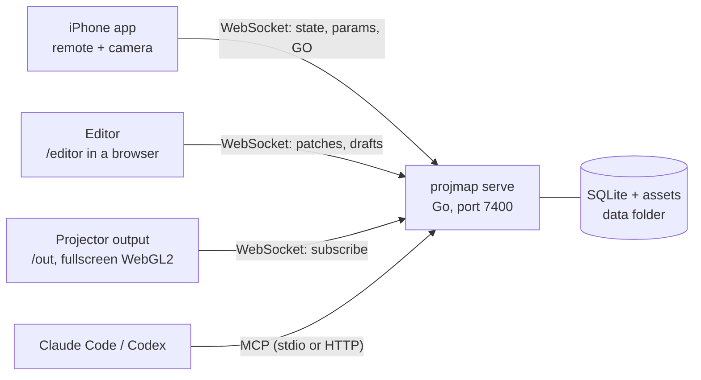

# projmap

**A projector as a creative light and a mapping tool.** Throw a soft gobo, a swaying tree or a blurred photo onto
the wall as a backdrop, or map light and animation onto the real objects in front of it.

One small Go server on your laptop (or a mini PC by the projector) owns every scene. The projector output and the
editor are web pages it serves, the iPhone app is a remote and a camera, and Claude Code or Codex can map and
animate over MCP. It runs on your local network and needs no internet.

`projmap` is a working name.

## What you can do

One mode is on air at a time, and each keeps its own settings when you switch away and back.

- **Static gobos.** Window frames, blinds, leaves and other shapes as light, with intensity, softness, angle,
  colour temperature or hue, and light effects such as candle, fire, lightning and TV flicker.
- **Live layers.** Procedural layers that move: a tree swaying in the wind, clouds, rain on glass, caustics, a day
  cycle. Stack them, blend them and save the stack as a preset.
- **Colour gradients.** Soft multi-stop washes with drift and grain.
- **Blurred scenery.** A photo (built in, or one from your phone) as a soft, out-of-focus backdrop with warmth,
  brightness and a slow drift.
- **Object mapping.** Draw faces over real objects in the editor (quads, triangles, polygons, circles, lines, mesh
  warps and masks), weld shared corners, and put pictures, drawings and effects on each face in the unfolded content
  view, where content runs on across shared edges. Preview in the editor without touching the wall, animate it on a
  timeline with cues and step through the cues with GO on the phone.
- **Auto map.** Put the iPhone on a stand next to the projector. The projector flashes Gray-code stripes, the phone
  photographs each one, and the server builds a dense camera to projector map and proposes surfaces to map.
- **Agents.** Claude Code and Codex connect over MCP. They read the scene, look at renders and camera frames, write
  effects and clips into a backstage draft, and hand you a proposal to preview, apply or discard.

## How it fits together



The server sends scene state (a few KB per change), not video. Every screen renders it locally with the same WebGL2
engine, so the editor stage and the phone previews show exactly what the wall shows. Edits from the editor and
from agents can go into a draft first; only an explicit apply or GO changes what is on air. The wire contract is in
[docs/protocol.md](docs/protocol.md).

## Quick start

Requirements: macOS (Apple Silicon or Intel) or Linux, Google Chrome for the projector output, and a projector on a
second display. The iPhone app is optional and is built from source for now.

```bash
curl -fsSL https://raw.githubusercontent.com/brushknight/projector-mapping/main/install.sh | sh -s -- --service
```

The installer downloads the latest release for your platform, checks it against the release's `SHA256SUMS`,
installs `projmap` to `~/.local/bin` and, with `--service`, starts the server at login (a launchd agent on macOS).
Without `--service`, run the server yourself:

```bash
projmap serve                       # port 7400; data in ~/Library/Application Support/projmap
```

Then:

```bash
projmap open                        # the editor in your browser (also prints a one-time link for another machine)
projmap open --out --display 2      # the projector output, fullscreen in a Chrome kiosk window on display 2
projmap pair                        # the 4-character pairing code for the phone
```

To pair the phone, open the iPhone app on the same Wi-Fi. It finds the server over Bonjour; type the code from the
projector (or `projmap pair`), or scan the QR code the projector shows. See
[docs/guides/getting-started.md](docs/guides/getting-started.md) for the full walk-through and
[docs/guides/projector-setup.md](docs/guides/projector-setup.md) for HDMI, kiosk and mini PC setups.

## Build from source

Requirements: Go 1.24, Node 22 or newer, and for the iPhone app Xcode 27 with
[xcodegen](https://github.com/yonaskolb/XcodeGen) (`brew install xcodegen`).

```bash
git clone https://github.com/brushknight/projector-mapping.git projmap && cd projmap/backend
make build                          # builds ../frontend into internal/web/dist, then one binary: ./projmap
./projmap serve
```

For development, run the server and Vite side by side:

```bash
cd backend && make dev              # server on :7400 with data in backend/.data
cd frontend && npm install && npm run dev   # editor with hot reload on http://localhost:5410/editor
```

Tests:

```bash
cd backend && make test             # Go tests; make lint for go vet + gofmt
cd frontend && npm run typecheck && npm test
cd ios && swift test --package-path Packages/PM
```

`make release VERSION=0.2.0` in `backend/` builds the release tarballs and `SHA256SUMS` into `dist/` for macOS and
Linux on arm64 and amd64. See [docs/releasing.md](docs/releasing.md).

## iPhone app

The app is native SwiftUI for iOS 26, iPhone only. The Xcode project is generated from `ios/project.yml`.

```bash
cd ios
xcodegen generate
open projmap.xcodeproj               # or build from the command line:

# simulator
xcodebuild -project projmap.xcodeproj -scheme projmap \
  -destination 'platform=iOS Simulator,name=iPhone 17 Pro' -derivedDataPath .build/dd build

# your iPhone (USB or Wi-Fi, Developer Mode on); TEAM is your Apple Developer team id
xcodebuild -project projmap.xcodeproj -scheme projmap -destination 'generic/platform=iOS' \
  -derivedDataPath .build/dd -allowProvisioningUpdates DEVELOPMENT_TEAM="$TEAM" build
xcrun devicectl device install app --device <device-id> .build/dd/Build/Products/Debug-iphoneos/projmap.app
```

`xcrun devicectl list devices` shows the device id. With your own team you may also need another bundle id:
add `PRODUCT_BUNDLE_IDENTIFIER=com.example.projmap` to the build. The app runs without a server too: "look around
without a projector" on the connect screen opens a demo. Details in
[docs/guides/iphone-app.md](docs/guides/iphone-app.md).

## Commands

```text
projmap [serve] [--port N] [--data DIR] [--no-bonjour]
                                    run the server (HTTP, WebSocket, MCP and the web app)
projmap open [--print]              open the editor and print a one-time login link for another machine
projmap open --out [--display N]    open /out in a Chrome kiosk window on display N (default 2; macOS)
projmap pair                        print the pairing code the projector shows
projmap mcp [--token T] [--url U]   stdio MCP bridge for Claude Code and Codex (starts the server if needed)
projmap sim [--url U]               fake phone camera and projector output, for trying calibration without hardware
projmap install                     install the launchd login item dev.projmap.server and start it (macOS)
projmap version                     print the version
```

Environment: `PROJMAP_DATA` (data folder), `PROJMAP_PORT` (7400), `PROJMAP_BIND` (0.0.0.0), `PROJMAP_BONJOUR=0`
(no Bonjour), `PROJMAP_SEED=0` (no sample scene on first run), `PROJMAP_URL` (the server the CLI subcommands talk
to).

## Agents over MCP

Claude Code:

```bash
claude mcp add projmap -- ~/.local/bin/projmap mcp
# or over HTTP while the server runs:
claude mcp add --transport http projmap http://127.0.0.1:7400/mcp
```

Codex (`~/.codex/config.toml`):

```toml
[mcp_servers.projmap]
command = "/Users/you/.local/bin/projmap"
args = ["mcp"]
```

Agents write into a backstage draft and finish with a proposal you apply from the editor. Two toggles in the
editor's agent panel, both off by default, let an agent preview on the projector or go live. You can also start an
agent from the editor or the phone; the server then runs `claude -p` or `codex exec` on this machine. More in
[docs/guides/agents-mcp.md](docs/guides/agents-mcp.md) and [docs/mcp-plan.md](docs/mcp-plan.md).

## Project layout

| path | what |
| --- | --- |
| `backend/` | Go module `projmap`: server, hub, MCP, agent runner, calibration and vision, CLI in `cmd/projmap` |
| `frontend/` | React + TypeScript + Vite: `/out`, `/editor`, `/preview`, `/components` and the WebGL2 renderer; builds into `backend/internal/web/dist` |
| `ios/` | SwiftUI iPhone app (xcodegen) and the local package `PM` (PMKit, PMStore, PMLive, PMDesign, PMCamera, PMPreview) |
| `contract/` | `catalog.json` (built-in gobos, layers, gradients, scenery, effects) and fixtures every client decodes in its tests |
| `design/` | design boards, HTML sources and scenery photos |
| `docs/` | [protocol](docs/protocol.md), [architecture](docs/architecture.md), [effects](docs/effects.md), [MCP plan](docs/mcp-plan.md), [guides](docs/guides/), [releasing](docs/releasing.md) |

## Guides

[Getting started](docs/guides/getting-started.md) ·
[Projector setup](docs/guides/projector-setup.md) ·
[Mapping](docs/guides/mapping.md) ·
[Auto map](docs/guides/auto-map.md) ·
[Agents and MCP](docs/guides/agents-mcp.md) ·
[iPhone app](docs/guides/iphone-app.md) ·
[Troubleshooting](docs/guides/troubleshooting.md)

## Contributing

Issues and pull requests are welcome. A few rules keep the three clients in step:

- The protocol is the contract. A change to a message or entity updates `docs/protocol.md`, `contract/fixtures`
  and all three decoders (Go, TypeScript, Swift) in the same pull request.
- The server is the only source of truth. Clients cache, but they never persist scene data on their own.
- Run the tests above before you open a pull request; CI runs them on every push.
- Copy in the apps uses active voice, no em dashes, and controls say what happens.

`CLAUDE.md` in the root and in `frontend/` describes the conventions for coding agents too.

## License

MIT. See [LICENSE](LICENSE).
