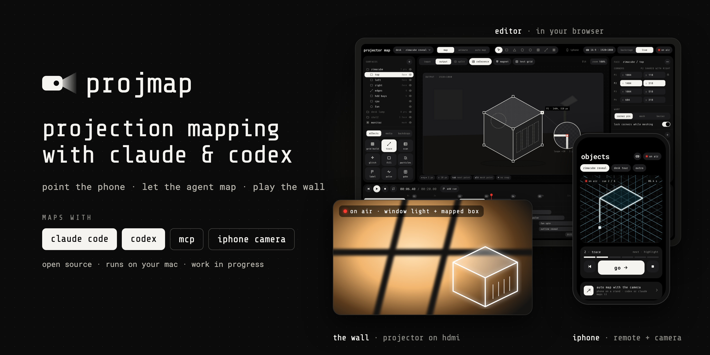
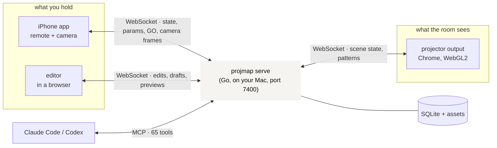
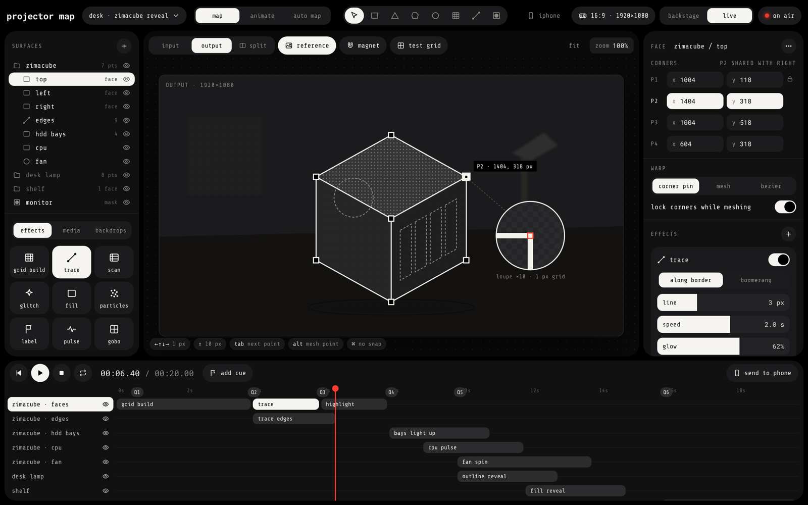
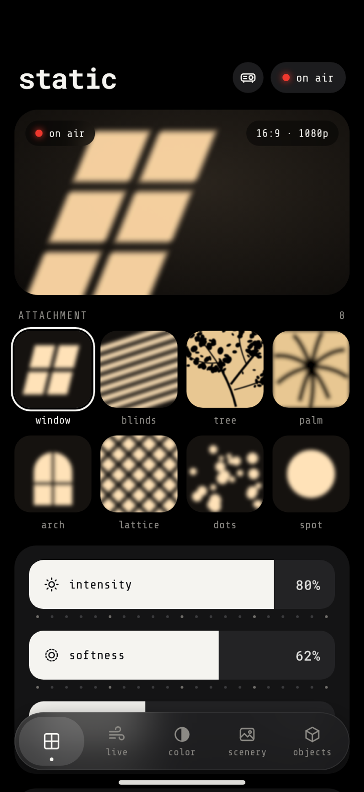
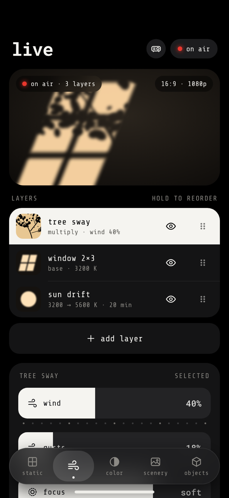
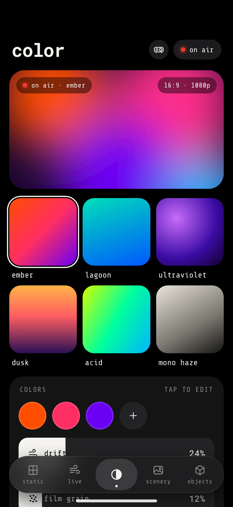
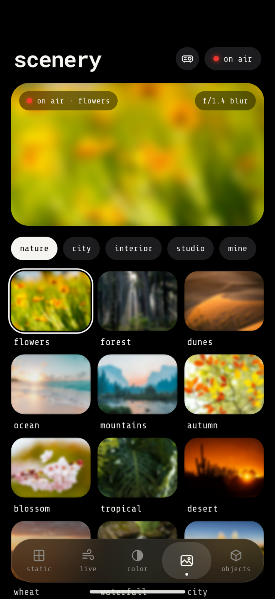
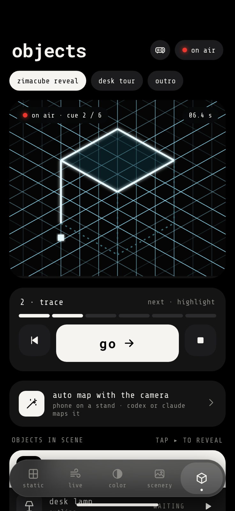
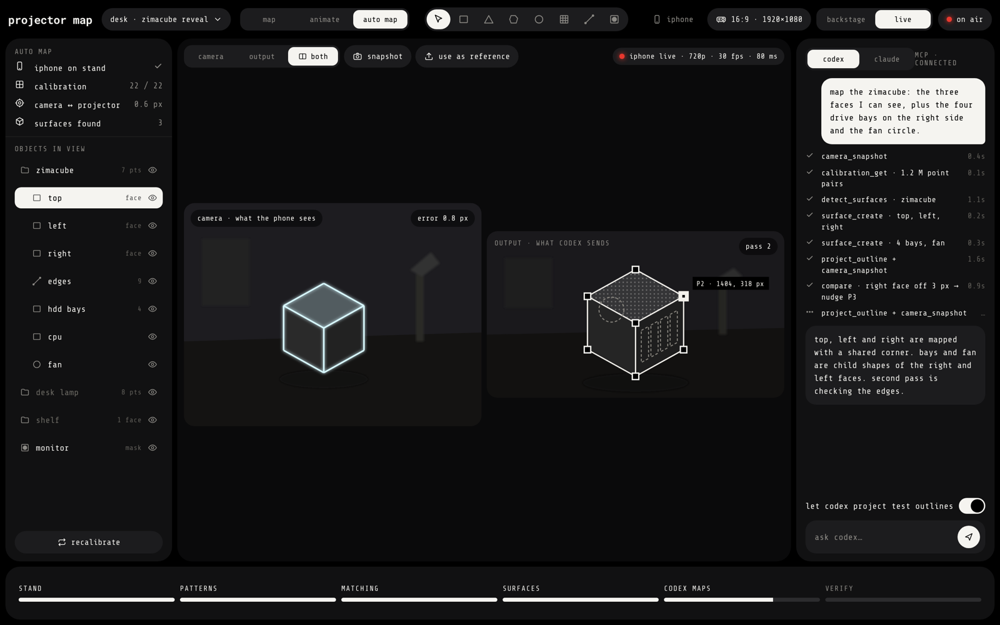

<p align="center"></p>

<p align="center">
  <a href="https://github.com/brushknight/projector-mapping/actions/workflows/ci.yml"></a>
  
  
  
</p>

# projmap

**Projection mapping with Claude and Codex**: point your iPhone at the scene, let the agent map the objects, and
play light on the wall from your phone.

A small server on your Mac drives a projector. It turns the projector into a creative light (plain light with
window, leaf and beam plates in front of it, gradients, animated colour, blurred photos) and into a mapping tool
that puts outlines, fills, drawings and animations onto the real objects in front of it. The iPhone app is the
remote and the camera. Claude Code or Codex connect over MCP, look at the scene through the phone, and do the
mapping for you: they draw the faces, check them against the camera, and put content on them. Everything runs on
your own network.

> **Work in progress.** I made the video on Instagram with this <!-- TODO: link the post -->, and it works for
> that, but it is far from finished. Expect rough edges and setup friction. Use it, break it, fork it, and build
> your own thing on top of it. Issues and feature requests are welcome.

- [What you need](#what-you-need)
- [Quick start](#quick-start)
- [How it works](#how-it-works): [the server](#the-server) · [the web app](#the-web-app) · [the iPhone app](#the-iphone-app) · [the agents](#the-agents)
- [Map an object with an AI agent](#map-an-object-with-an-ai-agent)
- [What you can put on the wall](#what-you-can-put-on-the-wall)
- [Commands](#commands) · [Known rough edges](#known-rough-edges) · [Ideas](#ideas-on-the-list) · [Contributing](#contributing) · [Docs](#docs)

## What you need

- **A Mac.** Apple Silicon is what I use; Intel and Linux build from source too.
- **A projector** on a second display, connected over HDMI.
- **Google Chrome** for the projector output.
- **To build it:** Go 1.24, Node 22 or newer. For the iPhone app, Xcode with
  [xcodegen](https://github.com/yonaskolb/XcodeGen) (`brew install xcodegen`).
- **Optional: an iPhone** on iOS 26, for the remote and the camera. A stand helps for auto map.
- **Optional: Claude Code or Codex**, for the AI mapping.

## Quick start

There are no prebuilt releases yet, so build it from a clone:

```bash
git clone https://github.com/brushknight/projector-mapping.git projmap && cd projmap/backend
make build          # builds the web app into one binary: ./projmap
./projmap serve     # port 7400; data in ~/Library/Application Support/projmap
```

Then, in another terminal:

```bash
./projmap open                      # the editor in your browser
./projmap open --out --display 2    # the projector output, full screen on display 2
./projmap pair                      # the pairing code for the phone
```

If the output window lands on the wrong screen, drag it to the projector and press ⌃⌘F. The server seeds a sample
scene, so the wall lights up right away. The full walk-through is in
[docs/guides/getting-started.md](docs/guides/getting-started.md).

## How it works



One server owns every scene. It sends scene state (a few KB per change), never video, and every screen renders it
with the same WebGL2 engine, so the editor, the phone preview and the wall always show the same picture. The wire
contract is [docs/protocol.md](docs/protocol.md).

### The server

`backend/`, Go. It stores scenes, setups, presets and assets in SQLite, runs the realtime hub every client connects
to, serves the web app, runs camera calibration and vision, and exposes the MCP tools. It advertises itself over
Bonjour, so the phone finds it on the Wi-Fi. One binary, no internet needed.

### The web app

`frontend/`, React and TypeScript, built into the server binary. It has three pages:

- **`/out`, the projector output.** A full-screen WebGL2 canvas on the projector's display. It draws the light, the
  plates, the mapped faces and the calibration patterns.
- **`/editor`, the editor.** Draw faces over objects, warp them, put content on them in an unfolded flat view, and
  animate them on a timeline with cues.
- **`/view`, the viewer.** The wall's picture in any browser, for checking a show from another room.

<p align="center"></p>

### The iPhone app

`ios/`, native SwiftUI. It is the remote you perform with: switch looks, slide through plates with one finger,
change the light with haptic sliders, step through a mapped sequence with GO, and play sounds. On a stand, it is
also the camera the server and the agents use to see the room.

<table>
<tr>
<td align="center" valign="top" width="20%"><br><b>static</b><br><sub>light, plates</sub></td>
<td align="center" valign="top" width="20%"><br><b>live</b><br><sub>moving layers</sub></td>
<td align="center" valign="top" width="20%"><br><b>color</b><br><sub>gradients</sub></td>
<td align="center" valign="top" width="20%"><br><b>scenery</b><br><sub>photos, video</sub></td>
<td align="center" valign="top" width="20%"><br><b>objects</b><br><sub>mapping, GO</sub></td>
</tr>
</table>

Build it with Xcode: `cd ios && xcodegen generate && open projmap.xcodeproj`, set your own team and bundle id, and
run it on your phone. Details in [docs/guides/iphone-app.md](docs/guides/iphone-app.md).

### The agents

Claude Code and Codex connect over MCP and get 65 tools: read the scene, render frames, take camera snapshots,
compare a render with what the camera sees, create and nudge surfaces, draw on faces in their own flat coordinates,
write timeline clips and cues, write custom GLSL or JavaScript effects, and play sounds.

Agents never touch the wall on their own. They work in a backstage draft and finish with a proposal you preview,
apply or throw away. Two switches in the editor, "agent may preview" and "agent may go live", stay off until you
turn them on.

## Map an object with an AI agent

1. **Put the phone on a stand** next to the projector, pointed at the object. Darken the room.
2. **Calibrate.** The projector flashes stripe patterns, the phone photographs each one, and the server learns
   which projector pixel lands where.
3. **Connect your agent** (the server must be running):

   ```bash
   claude mcp add --transport http projmap http://127.0.0.1:7400/mcp
   ```

   For Codex, add to `~/.codex/config.toml`:

   ```toml
   [mcp_servers.projmap]
   command = "/path/to/projmap"
   args = ["mcp"]
   ```

   `projmap mcp` is a stdio bridge that starts the server when none is running, so every Codex session keeps one
   alive while it is registered. Remove the entry when you are not using projmap.

4. **Ask for it.** For example: "Map the box on my desk: find its three visible faces, outline them, then fill each
   face with a slow white reveal." The agent looks through the camera, draws the faces, checks the alignment and
   writes the timeline into its draft.
5. **Preview and apply** in the editor, then play it from the phone with GO.

<p align="center"></p>

More in [docs/guides/auto-map.md](docs/guides/auto-map.md) and [docs/guides/agents-mcp.md](docs/guides/agents-mcp.md).

## What you can put on the wall

One mode is on air at a time, and each keeps its settings when you switch away and back.

- **Static light.** A spotlight with focus, intensity, colour temperature or hue, and light effects (candle, fire,
  lightning, TV flicker). 55 reference plates with adjustable window geometry go in front of it and stack as masks.
- **Live layers.** Moving layers under the light: a tree swaying, clouds passing, rain on glass, a day cycle.
- **Colour.** 28 gradients and animated colours (hue cycle, colour flow, pulse, aurora, kelvin cycle).
- **Scenery.** Blurred photos and video loops, including YouTube, as soft backdrops.
- **Objects.** Quads, triangles, polygons, circles, lines, mesh and Bezier warps, masks and details clipped to their
  face. Content runs across shared edges. Converge and morph transitions, an opening step that waits for GO, and
  sound on the timeline.

## Commands

```text
projmap [serve] [--port N] [--data DIR] [--no-bonjour]   run the server
projmap open [--print]              open the editor (prints a one-time link for another machine)
projmap open --out [--display N]    open the projector output full screen on display N (macOS)
projmap pair                        print the pairing code for the phone
projmap mcp [--token T] [--url U]   stdio MCP bridge for Claude Code and Codex (starts the server if needed)
projmap sim [--url U]               fake phone camera and output, to try calibration without hardware
projmap install                     start the server at login (launchd, macOS)
projmap version                     print the version
```

Environment: `PROJMAP_DATA` (data folder), `PROJMAP_PORT` (7400), `PROJMAP_BIND` (0.0.0.0), `PROJMAP_BONJOUR=0`
(no Bonjour), `PROJMAP_SEED=0` (no sample scene), `PROJMAP_URL` (the server the CLI talks to).

## Known rough edges

- The projector output is a Chrome window you place by hand.
- No AirPlay output yet; use an HDMI cable.
- Calibration needs a dark room and a steady phone.
- The server can use a lot of CPU in some setups; not fixed yet.
- No releases, no TestFlight build, no signed Mac app yet.

## Ideas on the list

- **Sequences:** plates, gradients and photos stepping every 0.25 s, with one play button.
- **The iPhone as the projector's source,** over a USB-C to HDMI adapter or AirPlay, so the Mac becomes optional.
- **Grid-first mapping on the phone,** plus box, cylinder and sphere surfaces.
- **LiDAR scanning,** so the phone measures the object and maps it in 3D.

Want one of these, or something else? [Open a feature request](https://github.com/brushknight/projector-mapping/issues/new?template=feature.md).

## Contributing

This is an open playground. [Report a bug](https://github.com/brushknight/projector-mapping/issues/new?template=bug.md),
ask for a feature, or take it as the base for your own project.

For pull requests, a few rules keep the three clients in step:

- The protocol is the contract. A change to a message or entity updates `docs/protocol.md`, `contract/fixtures` and
  all three decoders (Go, TypeScript, Swift) in the same pull request.
- The server is the only source of truth. Clients cache, but never persist scene data on their own.
- Run the tests: `cd backend && make test`, `cd frontend && npm run typecheck && npm test`,
  `cd ios && swift test --package-path Packages/PM`.

For development, run `make dev` in `backend/` and `npm run dev` in `frontend/` (the editor with hot reload).
`CLAUDE.md` describes the conventions for coding agents too.

## Docs

| | |
| --- | --- |
| [Getting started](docs/guides/getting-started.md) | install, first scene, pairing the phone |
| [Projector setup](docs/guides/projector-setup.md) | HDMI, full screen output, mini PC |
| [Mapping](docs/guides/mapping.md) | faces, warps, content and the timeline in the editor |
| [Auto map](docs/guides/auto-map.md) | camera calibration with the iPhone |
| [Agents and MCP](docs/guides/agents-mcp.md) | connecting Claude Code and Codex, drafts and proposals |
| [iPhone app](docs/guides/iphone-app.md) | building and installing the app |
| [Troubleshooting](docs/guides/troubleshooting.md) | when the wall, the phone or calibration misbehave |
| [Protocol](docs/protocol.md) · [Architecture](docs/architecture.md) · [Effects](docs/effects.md) | for contributors |

The hero image is built from `design/hero/hero.html` and the app's design boards in `design/boards/`.

## License

MIT: do whatever you want with it. See [LICENSE](LICENSE).
