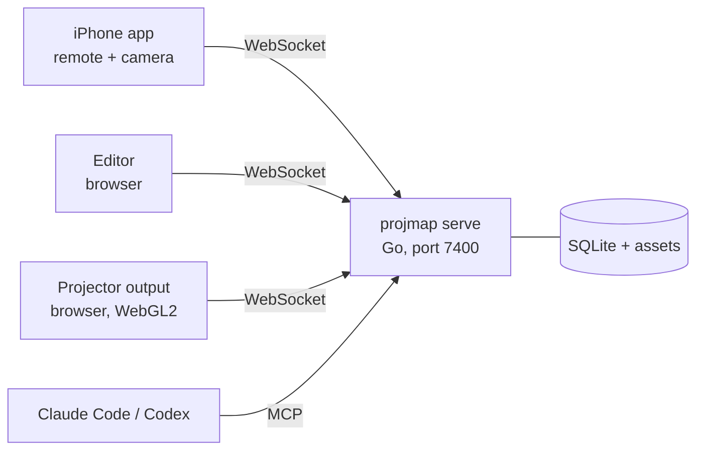

# projmap

**An AI-native projector light and projection mapping tool.** Point your iPhone at the scene, and let Claude or
Codex look through it and map the light onto the real objects in front of the projector.

> **Work in progress.** I made the video on Instagram with this <!-- TODO: link the post -->, and it
> works for that, but it is far from finished. Expect rough edges, setup friction and things that change. Use it,
> break it, fork it, and build your own thing on top of it.

<!-- TODO: a short clip or GIF of the wall here -->

## How it works

1. **The projector becomes a light.** A small server on your Mac drives the projector through a browser page. Start
   with plain light, then put plates in front of it like a real spotlight: window frames, leaves, blinds, beams. Or
   fill the wall with a gradient, an animated colour or a soft, blurred photo.
2. **The phone sees the scene.** Put the iPhone on a stand next to the projector. The projector flashes stripe
   patterns, the phone photographs each one, and the server learns which projector pixel lands where in the room.
3. **An agent does the mapping.** Claude Code or Codex connects over MCP. It looks at the scene through the phone's
   camera, finds the faces of the objects, draws surfaces on them, checks its work against new camera frames, and
   puts content on each face: outlines, fills, drawings, effects, animated reveals.
4. **You stay in control.** Agents work in a backstage draft. You preview it on the wall, then apply it or throw it
   away. Nothing goes live unless you turn that on.
5. **You perform from the phone.** Switch looks, scrub through plates with one finger, step through a mapped
   sequence with GO, play sounds. Every screen shows exactly what the wall shows.

## Why AI-native

Mapping by hand means dragging corners until they line up, face after face. projmap is built so an agent can do that
work with you:

- **65 MCP tools.** Read the scene, render frames, take camera snapshots, compare a render with what the camera
  sees, create and nudge surfaces, draw on faces in their own flat coordinates, write timeline clips and cues,
  write custom GLSL or JavaScript effects, and play sounds.
- **Eyes on the real room.** The iPhone camera and the Gray-code calibration give the agent a map from camera pixels
  to projector pixels, so it can check alignment instead of guessing.
- **Safe by default.** Drafts, proposals and two switches in the editor ("agent may preview", "agent may go live"),
  both off until you turn them on.
- **Runs locally.** Everything stays on your network. The agent is your own Claude Code or Codex.

## What is in it

- **Static light.** A spotlight with focus, intensity, colour temperature or hue, light effects (candle, fire,
  lightning, TV flicker) and 55 reference plates with adjustable window geometry. Plates stack as masks.
- **Live layers.** Moving layers under the light: a tree swaying, clouds passing, rain on glass, a day cycle.
- **Colour.** Gradients and animated colours (hue cycle, colour flow, pulse, aurora, kelvin cycle).
- **Scenery.** Blurred photos and video loops (including YouTube) as soft backdrops.
- **Object mapping.** Quads, triangles, polygons, circles, lines, mesh and Bezier warps, masks, details clipped to
  their face, an unfolded content view, a timeline with cues, converge and morph transitions, and an opening step.
- **Auto map.** iPhone camera calibration with Gray-code patterns.
- **Phone app.** A native SwiftUI remote with haptic sliders, scrub rails, a soundboard and a live preview.

## How it fits together



The server owns every scene and sends state, not video. Each screen renders it with the same WebGL2 engine. The wire
contract is [docs/protocol.md](docs/protocol.md).

## Try it

There are no prebuilt releases yet, so build it from source. You need macOS (or Linux), Go 1.24, Node 22 or newer,
Google Chrome, and a projector on a second display (HDMI).

```bash
git clone https://github.com/brushknight/projector-mapping.git projmap && cd projmap/backend
make build                          # builds the web app into the binary: ./projmap
./projmap serve                     # port 7400; data in ~/Library/Application Support/projmap
```

Then, in another terminal:

```bash
./projmap open                      # the editor in your browser
./projmap open --out --display 2    # the projector output, full screen on display 2
./projmap pair                      # the pairing code for the phone
```

If the output window lands on the wrong screen, drag it to the projector and press ⌃⌘F. The full walk-through is in
[docs/guides/getting-started.md](docs/guides/getting-started.md), and HDMI and mini PC setups are in
[docs/guides/projector-setup.md](docs/guides/projector-setup.md).

### Connect Claude Code or Codex

Start the server first, then register projmap for this project only:

```bash
claude mcp add --transport http projmap http://127.0.0.1:7400/mcp
```

For Codex, add to `~/.codex/config.toml`:

```toml
[mcp_servers.projmap]
command = "/path/to/projmap"
args = ["mcp"]
```

`projmap mcp` is a stdio bridge to the running server. It starts the server when none is running, so while it is
registered, every Codex session keeps a server alive. Remove the entry when you are not using projmap. See [docs/guides/agents-mcp.md](docs/guides/agents-mcp.md).

### The iPhone app

Native SwiftUI for iOS 26, built from source with Xcode and [xcodegen](https://github.com/yonaskolb/XcodeGen):

```bash
cd ios && xcodegen generate && open projmap.xcodeproj
```

Set your own team and bundle id, then run it on your phone. Details in
[docs/guides/iphone-app.md](docs/guides/iphone-app.md).

## Known rough edges

- The projector output is a Chrome window you place by hand.
- AirPlay output is not supported yet; use an HDMI cable.
- Calibration needs a dark room and a steady phone.
- The server can use a lot of CPU in some setups; this is not fixed yet.
- No releases, no TestFlight build, no signed Mac app yet.

## Ideas on the list

Preprogrammed sequences (plates, gradients and photos stepping every 0.25 s), the iPhone as the projector's source
over USB-C or AirPlay, grid-first mapping on the phone, box, cylinder and sphere surfaces, and LiDAR scanning so the
phone can measure the object and map it in 3D. Want one of these, or something else? Open an issue.

## Contributing

This is an open playground. Open issues for bugs, open feature requests for things you would like it to do, and
feel free to take it as the base for your own project.

If you send a pull request, a few rules keep the three clients in step:

- The protocol is the contract. A change to a message or entity updates `docs/protocol.md`, `contract/fixtures` and
  all three decoders (Go, TypeScript, Swift) in the same pull request.
- The server is the only source of truth. Clients cache, but never persist scene data on their own.
- Run the tests: `cd backend && make test`, `cd frontend && npm run typecheck && npm test`,
  `cd ios && swift test --package-path Packages/PM`.

`CLAUDE.md` describes the conventions for coding agents too.

## Project layout

| path | what |
| --- | --- |
| `backend/` | Go server: hub, MCP, agent runner, calibration and vision, CLI in `cmd/projmap` |
| `frontend/` | React + TypeScript: projector output, editor, previews and the WebGL2 renderer |
| `ios/` | SwiftUI iPhone app and its local package `PM` |
| `contract/` | `catalog.json` (plates, layers, gradients, scenery, effects) and fixtures every client tests against |
| `design/` | design boards, HTML sources and scenery photos |
| `docs/` | [protocol](docs/protocol.md), [architecture](docs/architecture.md), [effects](docs/effects.md), [MCP plan](docs/mcp-plan.md), [guides](docs/guides/) |

## License

MIT: do whatever you want with it. See [LICENSE](LICENSE).
